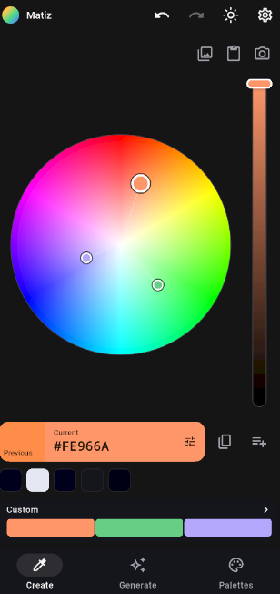
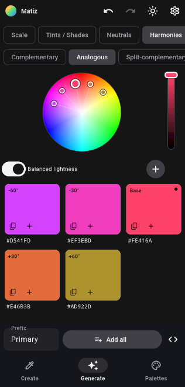
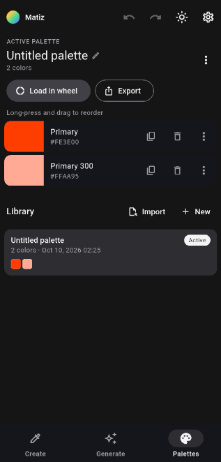

# Matiz para Android

[English](README.md) · **Español**

Versión móvil de [Matiz](../matiz): una herramienta de color pequeña y rápida para **tomar un color → entenderlo → armar una paleta → copiar / guardar → exportar**, rediseñada para pantallas táctiles.





## Características

- **Selector visual**: rueda de tono/saturación (centro blanco) con barra de brillo que muestra el propio color, barra Anterior | Actual y colores recientes; o una imagen como foco — pellizcar para hacer zoom, un dedo + lupa para elegir, mantener pulsado para añadir.
- **Elegir desde cualquier lado**: galería (selector de fotos del sistema — sin permisos), pegar cualquier formato, capturas vía **Compartir → Matiz**, cámara en vivo y burbuja flotante opcional (una única captura consentida).
- **Todos los formatos**: HEX, RGB, HSL, HSV, CMYK (aprox.), OKLCH, más fragmentos de código (CSS, C#/WPF, XAML, Flutter/Dart, ARGB); escribir un formato define el color.
- **Design Scale 50–950** generada en OKLCH, lista para sistemas de diseño.
- **Armonías** (complementaria, análoga, dividida, tríada, tétrada, monocromática) dibujadas en la rueda con luminosidad equilibrada, más tints/shades y neutros.
- **Set personalizado**: color principal + hasta 64 puntos secundarios, que se añaden manteniendo pulsada la rueda, la imagen, la cámara o la burbuja; **Personalizar** (desde imagen/cámara) carga los colores extraídos como puntos personalizados de una vez.
- **Paletas**: paleta activa con reordenado por arrastre, biblioteca con autoguardado, importar/exportar archivos **`.mpalette`** autocontenidos (compatibles con Matiz desktop), exportar PNG (paleta y superpuestos), copiar/compartir como **CSS variables, JSON, Dart, C#, Tailwind** o HEX.
- **Escala de grises** (1.1.1): slider 0–100 % en la paleta activa que mezcla en caliente cada color hacia su gris equivalente (Oklab) sin alterar los guardados; el % se recuerda por paleta, viaja en el `.mpalette` y las exportaciones salen tal como se ven.
- Deshacer/rehacer, interfaz en español / inglés, tema claro / oscuro.

> El motor de color (`packages/matiz_core`) es un port 1:1 en Dart de `Matiz.Core` de escritorio, verificado byte a byte contra él (ver *Paridad*).

## Requisitos

- Flutter 3.47+ (Dart 3.13+)
- Android SDK (plataforma 36, build-tools 36) y JDK 17
- Android 10 (API 29) o superior en el dispositivo

## Ejecutar

```bash
flutter pub get
flutter run                 # en un dispositivo conectado o emulador
```

## Tests

```bash
cd packages/matiz_core && dart test     # motor de color (incluye paridad con desktop)
flutter test                            # tests de widgets de la app
flutter analyze
```

### Paridad con desktop

`tool/golden` es una app de consola .NET que compila `Matiz.Core` de escritorio **leyendo** sus fuentes desde `../matiz` (no escribe nada allí) y vuelca resultados de referencia en `packages/matiz_core/test/fixtures/golden.json`: 2.000 colores (conversiones, escalas, armonías, tints, neutros), extracción k-means y exportación de código. `golden_parity_test.dart` debe coincidir exactamente.

```bash
cd tool/golden && dotnet run
```

## Compilar

```bash
flutter build apk --release        # pruebas locales (firma de depuración si no hay key.properties)
flutter build appbundle --release  # Google Play (requiere android/key.properties)
# Sin enlaces de donación (plan B ante la política de pagos de Play):
flutter build appbundle --release --dart-define=DONATIONS=false
```

## Estructura

```
packages/matiz_core/   Motor de color en Dart (sin Flutter) + tests
lib/state/             AppController (fuente única de verdad), ImageDoc
lib/ui/                Páginas Crear / Generar / Paletas / Ajustes / Cámara / Exportar
lib/widgets/           ColorWheel, BrightnessBar, ImageCanvas (lupa), tarjetas
lib/imaging/           Renderizadores PNG (paleta, superpuestos)
lib/platform/          Lado Dart del canal `matiz/platform`
android/.../kotlin/    MainActivity (compartir/abrir/portapapeles/galería/idioma), BubbleService, CaptureActivity
openspec/              Cambio y specs (spec-driven)
docs/vault/            Documentación de producto y técnica (vault de Obsidian)
```

## Licencia

Apache 2.0 con la [Commons Clause](https://commonsclause.com/): libre para copiar, modificar, compilar y distribuir; la venta del software queda reservada al autor. Ver [LICENSE](LICENSE).

## Apoyar el proyecto

Considerá donar si te es útil:

<a href="https://cafecito.app/juanquiroga"></a> <a href="https://www.paypal.com/ncp/payment/PJXDUSBHSE8DE"></a>